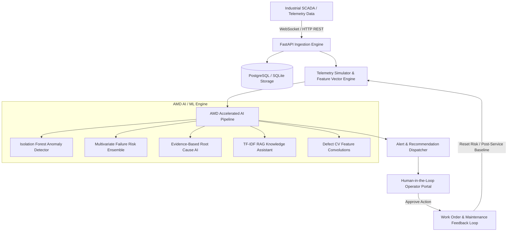

# ForgeSight AI — System Architecture

**Tagline:** Detect. Explain. Predict. Prevent.  
**Track:** AMD Developer Hackathon ACT III — Intelligent Industry

---

## Architecture Overview

ForgeSight AI is structured as a decoupled, micro-service capable industrial intelligence application.

---

## Core Components

1. **Frontend (Next.js 15 App Router + React + Tailwind CSS)**:
   - High information density SaaS dashboard for Plant Managers, Engineers, and Machine Operators.
   - Interactive live telemetry charts (Recharts) and real-time WebSocket state streaming.

2. **Backend Engine (FastAPI 0.142 + Pydantic v2 + SQLAlchemy 2.0)**:
   - Async REST API endpoints with role-based authentication.
   - Automated background simulation and real-time data ingestion.

3. **AMD Hardware Benchmarker & Compute Abstraction**:
   - `AmdBenchmarker` abstraction evaluating vector matrix operations, convolution tensors, and TF-IDF document embeddings across host CPU and AMD GPU / ROCm accelerators.

4. **Storage Engine**:
   - SQLAlchemy ORM database containing machines, telemetry frames, anomalies, risk predictions, recommendations, RAG chunks, and audit logs.
